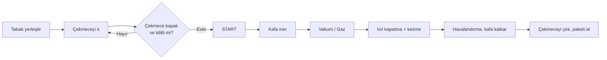

# Makine Profili — Cliopack TS-100 Yarı Otomatik Tabak Kapatma Makinası

> Kaynak: <https://www.cliopack.com/ts-100-yari-otomatik-tabak-kapatma-makinasi> (erişim: 23.10.2026)

## 1. Üretici sayfasındaki veriler

| Özellik | Değer |
|---|---|
| Kullanım alanı | Taze/pişmiş et, şarküteri, sebze, meyve, hazır yemek, kuruyemiş, bakliyat, unlu mamuller |
| Paketleme yöntemi | Tabak (tray) üzerine film kapatma; gazlı (MAP) veya gazsız vakum |
| Maks. tabak ölçüleri | 1 × 325 × 265 mm · 1 × 227 × 178 mm · 2 × 190 × 144 mm |
| Maks. film çapı / genişliği | 220 mm / 340 mm |
| Gövde malzemesi | AISI 304 paslanmaz çelik |
| Besleme | 220–240 V, 50 Hz |
| Güç | 1,5–3 kW |
| Vakum pompası | Opsiyonel · standart 20, opsiyonel 25 (sayfada "m³/s" yazıyor; bu sınıf makinede birim büyük olasılıkla m³/h) |
| Ölçüler (U × G × Y) | 930 × 1250 × 690 mm |
| Ağırlık | 120 kg |
| Çevrim hızı | Gazlı 2–3 çevrim/dk · gazsız 4–6 çevrim/dk |
| Kumanda | IP65 butonlar, LCD panel, 13 dil (TR, EN, RU, DE, FR, IT, ES, SR, PT, AR, EL, HR, HI) |
| Diğer | Gaz basma, değiştirilebilir kalıp sistemi, opsiyonel baskı-merkezleme (fotosel) sensörü, sessiz/titreşimsiz çalışma, CE standartlarına göre üretim |
| Yalnızca TS-120 SE'de | Otomatik kayar çekmece ve ürün kaldırma tablası → **TS-100'de çekmece manueldir** |

## 2. Sayfada olmayan, laboratuvar için yaptığımız varsayımlar

Üretici sayfası kontrol mimarisi, emniyet donanımı ve ağ bağlantısı hakkında bilgi vermiyor. Föyleri doldurabilmek için bu sınıftaki makinelerde yaygın olan yapıyı varsaydık. **Gerçek değerlendirmede bunların hepsi üreticiden (teknik dosya, kullanma kılavuzu, elektrik/pnömatik şema) teyit edilmelidir.**

| # | Varsayım | Gerekçe |
|---|---|---|
| V1 | Kapatma kafası (ısıtma plakası + kalıp) **pnömatik silindirle** iner/kalkar; basınçlı hava ~6 bar | Bu sınıf tabak kapatma makinelerinde yaygın tahrik |
| V2 | Kontrol: kompakt **PLC + LCD HMI** (reçete: sıcaklık, kapatma süresi, vakum/gaz süresi) | "LCD panel", "gazlı/gazsız mod", çok dilli menü programlanabilir kontrolcüye işaret eder |
| V3 | Emniyet donanımı: **acil stop**, **çekmece kapalı/kilitli sensörü (interlock)**, ısıtıcı için **aşırı sıcaklık sınırlayıcı**; bunlar bir **emniyet rölesi / küçük Safety PLC** üzerinden | CE işaretli makinede kapanma ve sıcak yüzey riskleri için beklenen asgari önlemler (2006/42/EC Ek I) |
| V4 | Isıtma plakası sıcaklığı ~150–200 °C (film tipine göre) | Tipik heat-seal film değerleri |
| V5 | Gaz: N₂ / CO₂ veya karışımı, harici tüp + regülatörle | MAP uygulaması |
| V6 | **Bağlantı senaryosu (föy gereği):** Makine bir gıda tesisinde hatta entegre; servis firması için 4G/VPN modemli uzaktan erişim, reçete aktarımı için USB, üretim sayısı için MES/ERP bağlantısı | Bootcamp föyleri "dijital kesişim noktası" ve uzak erişim istediği için Endüstri 4.0'a bağlanmış bir TS-100 modelliyoruz. Standart TS-100'de bu bağlantılar olmayabilir. |

## 3. Çalışma döngüsü (varsayımsal)

1. Operatör tabağı/tabakları kalıba yerleştirir.
2. Operatör çekmeceyi **elle** içeri iter → çekmece sensörü "kapalı" bildirir.
3. Operatör START'a basar → kapatma kafası iner, film tabağın üzerine bastırılır.
4. Vakum çekilir → (gazlı modda) koruyucu gaz basılır.
5. Isıtma plakası filmi tabağa kaynatır, bıçak/kesici filmi kenardan keser.
6. Hazne havalandırılır, kafa kalkar, operatör çekmeceyi çekip paketi alır.

