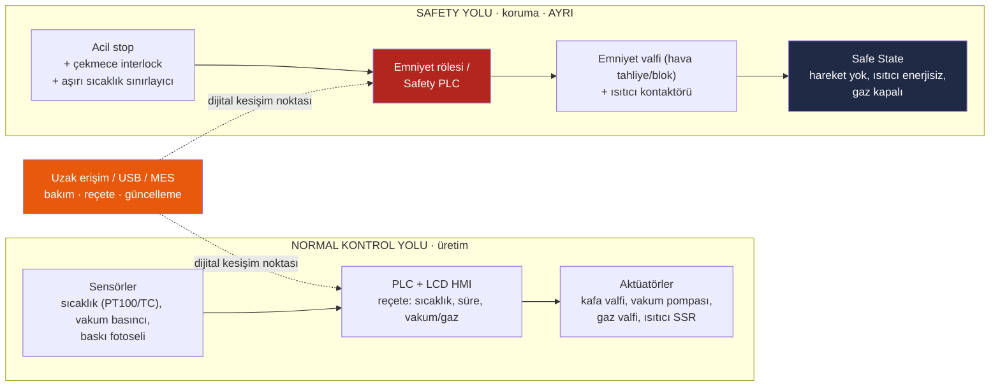

# LAB 1 · Safety Architecture — Cliopack TS-100

**Çıktı:** Safety Function Map → Evidence Pack **EP 03 Safety Functions**

| Ad Soyad | Grup | Tarih |
|---|---|---|
| Ensar Daş | | 23.10.2026 |

> Kavram: Emniyet fonksiyonu insanı koruyan fonksiyondur ve ayrı bir safety yolunda yaşar (E-stop → Safety PLC → STO). Gerekli güvenilirliği (PLr/SIL) riskle orantılıdır — ve bu güvenilirlik dijital bir konfigürasyona bağlıdır.
>
> Varsayımlar için bkz. [00-makine-profili.md](00-makine-profili.md).

## Mimari şema (TS-100'e uyarlanmış)

## Görev

### 1 · Bu makinede tehlike nedir? İnsan neyden zarar görür?

| Tehlike | Kaynak | Olası zarar |
|---|---|---|
| **Ezilme / sıkışma** | Pnömatik kapatma kafası ile kalıp arası, çekmece kenarı | El/parmak ezilmesi, kırık |
| **Yanma** | ~150–200 °C ısıtma plakası, sıcak kalıp | Termal yanık |
| **Kesilme** | Film kesme bıçağı | Kesik |
| **Elektrik çarpması** | 230 V besleme, 1,5–3 kW ısıtıcı devresi, ıslak ortam (gıda tesisi yıkaması) | Elektrik çarpması |
| **Basınçlı gaz / boğulma** | N₂/CO₂ tüpü, kapalı küçük odada sızıntı | Oksijen yetersizliği, tüp hasarı |
| **Gıda güvenliği (dolaylı)** | Hatalı kapatma / eksik gaz → sızdıran paket | Tüketicide gıda zehirlenmesi |

En kritik doğrudan tehlike: **operatör her çevrimde elini kalıba sokar** (yarı otomatik, TS-100'de çekmece manuel). Kafa yanlış anda inerse el ezilir ve aynı anda yanar.

### 2 · Safety function (emniyet fonksiyonu) hangisidir?

| Kod | Emniyet fonksiyonu | Tetikleyici → tepki |
|---|---|---|
| **SF1** | **Çekmece kilitlemeli kapanma izni** | Çekmece tam kapalı ve kilitli değilse kafa inemez; çevrim sırasında çekmece açılmaya çalışılırsa hareket durur |
| **SF2** | **Acil durdurma** | E-stop → kafa hareket enerjisi kesilir, ısıtıcı ve gaz valfi enerjisiz (Stop kategori 0/1) |
| **SF3** | **Aşırı sıcaklık kesmesi** | Plaka sıcaklığı sınırı aşarsa bağımsız sınırlayıcı ısıtıcı kontaktörünü açar |
| **SF4** | **Beklenmedik yol almanın önlenmesi** | Enerji/hava geri geldiğinde makine kendiliğinden çalışmaz; yeni START gerekir |

Bu föyde ana fonksiyon olarak **SF1 + SF2** (ezilme/yanma riskini doğrudan karşılayanlar) ele alınır.

### 3 · Safety-related control system nerede? (şemada işaretli)

Şemadaki kırmızı blok ve kırmızı yol: **çekmece interlock sensörü + acil stop butonu → emniyet rölesi / Safety PLC → emniyet valfi (pnömatik) + ısıtıcı kontaktörü**. Normal PLC ve HMI bu zincirin **parçası değildir**; sadece durum bilgisi okur. Aşırı sıcaklık sınırlayıcısı da bu yola dahildir (PLC'den ayrı, kendi sensörüyle).

### 4 · Normal PLC ile Safety PLC farkı nedir?

| | Normal PLC | Safety PLC / emniyet rölesi |
|---|---|---|
| Amaç | Üretim: reçete, sıralama, kalite | İnsanı korumak: güvenli duruma geçirmek |
| Arıza davranışı | Arızada ne yapacağı tanımsız olabilir | Arıza **güvenli yöne** düşer (fail-safe), kendini sürekli test eder |
| Mimari | Tek kanal | Çift kanal (redundant), karşılıklı izleme, diagnostik |
| Değişiklik | Operatör/servis reçeteyi kolayca değiştirir | Program/konfigürasyon kilitli, imzalı (checksum), değişiklik = yeniden validasyon |
| Sertifikasyon | Gerekmez | ISO 13849 / IEC 62061 kapsamında PL/SIL ile sertifikalı |

### 5 · PLr / SIL neden var? Bu fonksiyon için neden önemli?

Her emniyet fonksiyonunun "ne kadar güvenilir" olması gerektiği riske göre belirlenir. ISO 13849-1 risk grafiğiyle eğitim amaçlı tahmin:

| Fonksiyon | S (ciddiyet) | F (maruziyet) | P (kaçınma) | **PLr** |
|---|---|---|---|---|
| SF1 çekmece interlock | S2 – ezilme + yanık, kalıcı | F2 – her çevrimde, dakikada 2–6 kez | P2 – kafa hızlı iner, kaçınma zor | **PL d** |
| SF2 acil stop | S2 | F2 | P1/P2 | **PL c–d** |
| SF3 aşırı sıcaklık | S1–S2 | F2 | P1 | **PL c** |

Önemi: Operatörün eli dakikada birkaç kez tehlike bölgesine giriyor. Fonksiyon "çoğunlukla çalışıyor" yetmez; tek bir sensör arızası ya da yazılım hatası eli ezmemeli. PLr d, iki kanal ve arıza tespiti ister. Bu da emniyet fonksiyonunun basit bir PLC satırı olarak yazılamayacağını gösterir.

### 6 · Safe state (güvenli durum) nedir?

- Kapatma kafası **hareket etmiyor**. Kafa yukarıdaysa yukarıda kalır, aşağıdaysa düşme/inme yok. Pnömatikte hava tahliyesi yerçekimiyle inmeye yol açmamalı; çift etkili silindir + bloke valf veya mekanik kilit gerekir.
- **Isıtıcı enerjisiz** (kontaktör açık).
- **Gaz valfi kapalı**, hazne havalandırılmış (basınç/vakum kalmamış).
- Çekmece açılabilir, ancak yeniden başlatma yalnızca **bilinçli bir START** ile olur (SF4).

Not: Isıtma plakası kapandıktan sonra da bir süre sıcak kalır. Güvenli durum "soğuk" demek değildir; sıcak yüzey uyarısı ve koruyucu kapak gerekir.

### 7 · Safety function hangi dijital bağımlılıklara sahip?

- **Emniyet rölesi / Safety PLC programı ve parametreleri** (interlock mantığı, durdurma kategorisi, gecikme süreleri), firmware sürümü
- **Interlock sensörünün konfigürasyonu** (kodlu manyetik/RFID sensörse eşleştirme kodu)
- **Normal PLC programı:** interlock (yanlış tasarımla) normal PLC'de çözüldüyse fonksiyon tamamen ona bağımlı olur
- **HMI reçete parametreleri:** kapatma sıcaklığı/süresi, kafa iniş hızı, vakum/gaz süreleri. Doğrudan emniyet fonksiyonu değiller ama yanık ve gıda güvenliği riskini değiştirirler.
- **Aşırı sıcaklık sınırlayıcısının ayar değeri** (dijital termostat ise menüden değiştirilebilir)
- **Zaman/sayaç verisi, olay kayıtları** (kanıt ve bakım için)
- Mühendislik yazılımı + dizüstü bilgisayar, USB ile reçete/firmware aktarımı, uzak servis modemi

### 8 · Siber müdahale hangi noktadan bu fonksiyonu bozar?

1. **Uzak servis modemi → PLC/HMI:** Servis hesabı ele geçirilirse reçete parametreleri (sıcaklık, süre) değiştirilebilir. Emniyet yolu PLC'den ayrı değilse interlock bypass edilir.
2. **Mühendislik dizüstü bilgisayarı:** Zararlı yazılım bulaşmış dizüstüyle PLC'ye ya da Safety PLC'ye değiştirilmiş program yüklenir. Bu, föydeki "dijital kesişim noktası"dır.
3. **USB reçete/firmware aktarımı:** Sahte firmware veya aşırı sıcaklık ayarı.
4. **Dijital termostat menüsü:** Sınırlayıcı değeri yükseltilirse SF3 devre dışı kalır.

**Ana kural:** Safety PLC/röle ağa bağlı değilse, programı kilitliyse (parola + checksum) ve interlock donanımla (hard-wired) çalışıyorsa, siber saldırgan reçeteyi bozsa bile **eli ezemez**. Saldırı yüzeyi normal kontrol yoluyla sınırlı kalır.

---

## Safety Function Map (özet)

| SF | Tehlike | Giriş | Mantık | Çıkış | Safe state | PLr | Dijital bağımlılık | Siber giriş noktası |
|---|---|---|---|---|---|---|---|---|
| SF1 | Ezilme + yanık | Çekmece kodlu interlock (2 kanal) | Safety PLC / röle | Emniyet valfi (hava blok/tahliye) | Kafa hareketsiz | d | Safety programı, sensör kodu | Mühendislik PC, uzak servis |
| SF2 | Tüm hareketli/enerjili tehlikeler | E-stop (2 kontak) | Safety PLC / röle | Emniyet valfi + ısıtıcı kontaktörü + gaz valfi | Hareket yok, enerji yok | c–d | Durdurma kategorisi ayarı | Mühendislik PC |
| SF3 | Aşırı ısınma, yanık, yangın | Bağımsız termokupl | Sınırlayıcı termostat | Isıtıcı kontaktörü | Isıtıcı enerjisiz | c | Limit değeri | HMI/USB (dijital termostatsa) |
| SF4 | Beklenmedik çalışma | Enerji/hava dönüşü | Safety PLC | Reset gerekliliği | Bekleme | c | Reset mantığı | Mühendislik PC |

*Bu föy bir eğitim çıktısıdır; resmî denetim, uygunluk değerlendirmesi veya belgelendirme değildir.*
