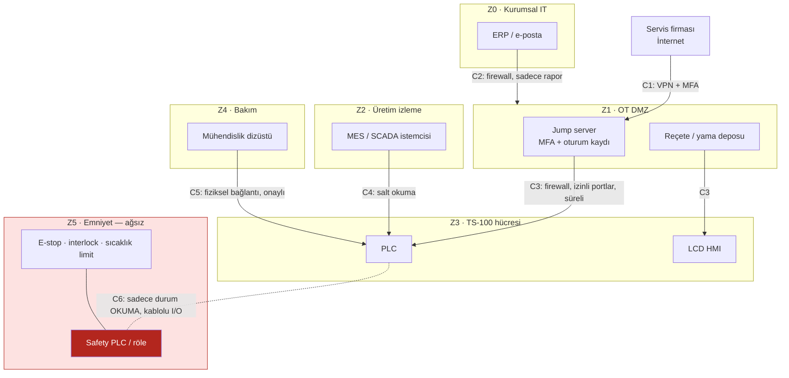

# LAB 2 · IEC 62443 Mini Workshop — Cliopack TS-100

**Çıktı:** Zone / Conduit Diagram → Evidence Pack **EP 05 Zone & Conduit**

| Ad Soyad | Grup | Tarih |
|---|---|---|
| Ensar Daş | | 23.10.2026 |

> Kavram: Zone, benzer kritiklikteki cihazları bir bölgede toplar. Conduit, bölgeler arası her geçişe konan kontrollü bir kapıdır. 62443'ün maddeleri ezberlenmez, mantığı uygulanır.
>
> TS-100 tek başına çalışan kompakt bir makinedir. Bu föyde makineyi bir gıda paketleme tesisine bağlı varsayıyoruz (bkz. [V6](00-makine-profili.md)).

## Görev A — varlıkları bölgelere ayırın

**Varlık listesi (TS-100'e uyarlanmış):**

| Föydeki varlık | TS-100 karşılığı |
|---|---|
| PLC | Makine kontrol PLC'si (reçete, çevrim sıralaması) |
| HMI | LCD operatör paneli |
| Robot kontrolörü | **TS-100'de yok.** Hatta varsa: besleme konveyörü / etiketleme ünitesi kontrolörü |
| Safety PLC | Emniyet rölesi / küçük Safety PLC (E-stop, çekmece interlock), aşırı sıcaklık sınırlayıcı |
| SCADA istemcisi | Üretim izleme / MES terminali (paket sayısı, reçete, alarm) |
| Mühendislik istasyonu | Servis/bakım dizüstü bilgisayarı (PLC ve HMI yazılımı) |
| Uzak servis erişimi | Üretici/servis firmasının 4G-VPN modemi |
| Ofis ağı (ERP/e-posta) | Tesis ERP'si, sipariş, e-posta |

### 1 · Hangi varlıklar aynı bölgede? Bölgeleri adlandırıp gruplandırın.

| Zone | Ad | Varlıklar | Kritiklik | Hedef SL |
|---|---|---|---|---|
| **Z0** | Kurumsal (IT) | ERP, e-posta, ofis PC'leri | Düşük (OT için güvenilmez) | — |
| **Z1** | OT DMZ | Jump server, yama/reçete deposu, uzak erişim ağ geçidi | Orta | SL 2 |
| **Z2** | Üretim izleme | MES/SCADA istemcisi, tarihçe sunucusu | Orta | SL 2 |
| **Z3** | Makine hücresi (TS-100 kontrol) | PLC, LCD HMI, (varsa) konveyör/etiketleyici kontrolörü | Yüksek | SL 2 |
| **Z4** | Bakım | Mühendislik dizüstü bilgisayarı (yalnızca bakım sırasında bağlanır) | Yüksek (en yetkili cihaz) | SL 2 |
| **Z5** | Emniyet (SIS) | Emniyet rölesi / Safety PLC, E-stop, çekmece interlock, aşırı sıcaklık sınırlayıcı | **En yüksek** | SL 3 / ağsız |

### 2 · Safety PLC'yi hangi bölgeye koydunuz — neden?

**Kendi bölgesine (Z5), ağa bağlı olmadan.** Nedenleri:

- Elleri ezilmekten koruyan fonksiyon (çekmece interlock + E-stop) burada çalışıyor; risk seviyesi diğer tüm varlıklardan yüksek (PLr d).
- PLC ve HMI reçete için sık sık değiştirilir, USB ve uzak erişim alır. Saldırı yüzeyleri büyüktür. Safety PLC onlarla aynı bölgede olursa Z3'ü ele geçiren saldırgan emniyete de ulaşır.
- TS-100 küçük bir makine. Emniyet mantığı kablolu (hard-wired) emniyet rölesiyle çözülebilir, bu yüzden ağ bağlantısına gerek yok.
- PLC'ye yalnızca **durum sinyali** verir (ör. "çekmece kapalı", "E-stop basılı"). PLC'den emniyet yoluna **yazma yolu yoktur**.
- Program değişikliği yalnızca yerinde, parola + checksum ile ve yeniden validasyonla yapılır.

### 3 · Bölgeler arası geçişler (conduit) nerede? Her geçişte ne kontrol edilecek?

| Conduit | Geçiş | Kontrol |
|---|---|---|
| **C1** | İnternet (servis firması) → Z1 | Site-to-site/istemci VPN, **MFA**, kişisel hesap, varsayılan kapalı (talep + onay ile açılır), IP kısıtlama |
| **C2** | Z0 Kurumsal → Z1 | Firewall; IT'den OT'ye doğrudan bağlantı yok, yalnızca DMZ'deki rapor/veri sunucusuna erişim. E-posta/web OT'ye geçmez. |
| **C3** | Z1 → Z3 (TS-100) | Firewall'da yalnızca jump server'dan PLC/HMI'ın gerekli portlarına izin, oturum kaydı, zaman sınırı; reçete dosyaları imza/hash kontrolünden geçer |
| **C4** | Z2 MES ↔ Z3 | Yalnızca okuma (sayaç, alarm, reçete adı). MES'ten PLC'ye yazma kapalı ya da reçete seçimiyle sınırlı (parametre değiştirme yok). |
| **C5** | Z4 Mühendislik dizüstü → Z3 | Yalnızca bakım sırasında fiziksel kablo; dizüstü güncel, antivirüslü, yalnızca bu iş için kullanılıyor; PLC'de değişiklik parolası; yükleme öncesi/sonrası program yedeği ve karşılaştırma. USB portları kilitli, USB'ler tarandıktan sonra takılır. |
| **C6** | Z5 Emniyet → Z3 | Ağ yok, kablolu I/O ile **tek yönlü durum bilgisi**. PLC emniyet çıkışlarını süremez. |

## Görev B — uzak erişim kararı

| Karar | Seçenekler | Seçimimiz + nedeni |
|---|---|---|
| **Aracı?** | Doğrudan / Jump server | **Jump server (Z1'de).** Servis firması TS-100'ün PLC'sine doğrudan ulaşmaz; tüm erişim tek, izlenebilir bir noktadan geçer, firewall kuralları sade kalır. |
| **Tünel?** | Açık / VPN | **VPN.** Açık port (port yönlendirme, VNC/TeamViewer açık) internetten taranabilir. VPN trafiği şifreler ve yalnızca kimliği doğrulanmış kullanıcıyı içeri alır. |
| **Kimlik?** | Parola / MFA | **MFA.** Servis parolaları sızar ve yeniden kullanılır. İkinci faktör, çalınmış bir parolanın tek başına işe yaramamasını sağlar. |
| **Hesap?** | Paylaşılan / Kişisel | **Kişisel.** "service/1234" gibi paylaşılan bir hesapla reçeteyi kimin değiştirdiği bilinemez. Kişisel hesap izlenebilirlik sağlar ve ayrılan teknisyenin erişimi tek tıkla kapatılır. |
| **Kayıt?** | Yok / Tam oturum kaydı | **Tam oturum kaydı.** Sıcaklık/süre gibi parametre değişikliklerinin kanıtı olur; olay müdahalesinde (Lab 6) ve CRA bildiriminde gerekir. |
| **Zamanlama?** | Sürekli açık / Varsayılan kapalı | **Varsayılan kapalı.** Vardiya sorumlusu talep üzerine erişimi belirli bir süre için açar (ör. 2 saat), süre bitince bağlantı otomatik kapanır. Makine üretimdeyken uzaktan parametre yazma kapalıdır. |

*Bu föy bir eğitim çıktısıdır; resmî denetim, uygunluk değerlendirmesi veya belgelendirme değildir.*
