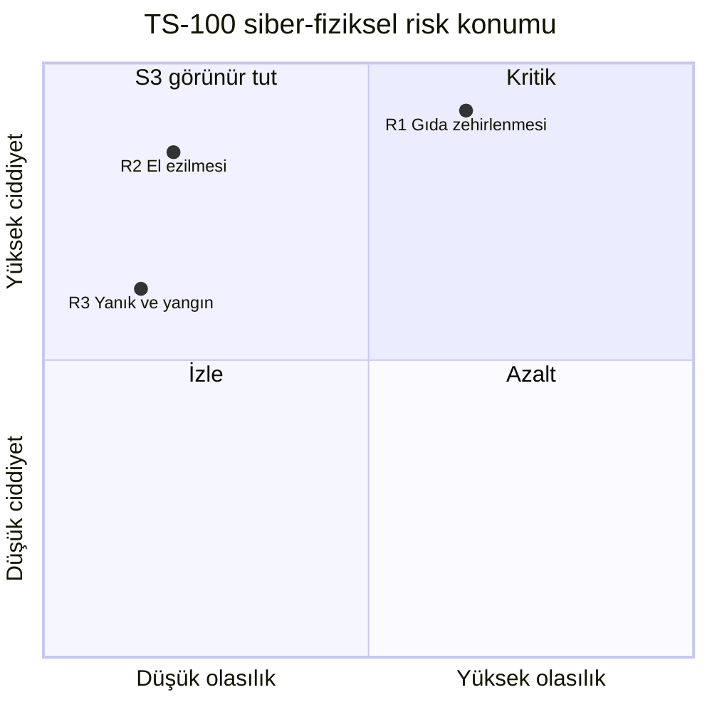

# LAB 3 · Threat & Risk + Risk Matrix — Cliopack TS-100

**Çıktı:** Risk Register → Evidence Pack **EP 04 Risk Assessment**

| Ad Soyad | Grup | Tarih |
|---|---|---|
| Ensar Daş | | 23.10.2026 |

> Kavram: Bir senaryo beş parçadan oluşur: **kim → hangi kapı → ne yapar → zincir → FİZİKSEL sonuç**. Skor = L × S × E (her biri 1–3).
> **Kural:** S=3 ise skor düşük olsa bile senaryo öne alınır; insana gelecek zarar görünür kalmalıdır.

**Ölçek:**

| Puan | L – Olasılık | S – Ciddiyet (insana) | E – Maruziyet |
|---|---|---|---|
| 1 | Zor; özel bilgi ve fiziksel erişim gerekir | Hafif / ilk yardım; sadece üretim kaybı | Nadiren (ayda birkaç kez) |
| 2 | Mümkün; bilinen yöntemlerle | Tedavi gerektiren yaralanma / hastalık | Vardiyada birkaç kez |
| 3 | Kolay; sık görülen saldırı | Kalıcı yaralanma, ağır hastalık, ölüm | Sürekli / her çevrimde |

## Görev — üç senaryo

| # | Senaryo (kim → kapı → ne yapar → zincir → fiziksel sonuç) | L | S | E | Skor | Öncelik |
|---|---|---|---|---|---|---|
| **R1** | **Kim:** Servis firmasının paylaşılan parolasını ele geçiren dış saldırgan. **Kapı:** Sürekli açık 4G uzak erişim modemi (VPN/MFA yok). **Ne yapar:** HMI'da reçeteyi değiştirir: kapatma sıcaklığını ve süresini düşürür, gaz süresini kısaltır. **Zincir:** Film tam kaynamaz, MAP gazı kaçar, paketler dışarıdan sağlam görünür, sevkiyata çıkar. **Fiziksel sonuç:** Taze et/hazır yemekte bakteri üremesi, **tüketicide gıda zehirlenmesi** (Listeria/Salmonella, ağır vakada ölüm). | 2 | 3 | 3 | **18** | 🔴 **Kritik** |
| **R2** | **Kim:** Zararlı yazılım bulaşmış servis teknisyeninin dizüstü bilgisayarı (farkında olmadan). **Kapı:** Mühendislik bağlantısı (Z4 → Z3); interlock'un normal PLC yazılımında çözüldüğü varsayımı. **Ne yapar:** Değiştirilmiş PLC programı yüklenir; "çekmece kapalı" koşulu yazılımda her zaman doğru kabul edilir. **Zincir:** Operatör kalıba tabak yerleştirirken START'a basılır ya da çevrim kendiliğinden başlar, kafa iner. **Fiziksel sonuç:** Operatörün **eli/parmakları ezilir ve 150–200 °C plakada yanar** (kalıcı yaralanma). | 1 | 3 | 3 | **9** | 🟠 **Yüksek** |
| **R3** | **Kim:** İçeriden kötü niyetli/hatalı kişi ya da enfekte USB. **Kapı:** HMI USB portu (reçete/firmware yükleme). **Ne yapar:** Isıtıcı ayar değerini ve dijital aşırı sıcaklık sınırlayıcısının limitini yükseltir. **Zincir:** Plaka aşırı ısınır, film ve tabak erir/yanar, duman ve yangın başlangıcı olur; operatör sıkışan tabağı elle almaya çalışır. **Fiziksel sonuç:** **Ağır yanık, yangın**, duman soluma. | 1 | 3 | 1 | **3** | ⚪ Düşük → **S=3 kuralıyla YÜKSEK'e alındı** |

**Bant:** Kritik 18–27 · Yüksek 9–17 · Orta 4–8 · Düşük 1–3

### Risk matrisi (konum)

### 1 · En yüksek öncelikli senaryonuz hangisi? Bir cümleyle: neden bu?

**R1 (reçete manipülasyonu → hatalı kapatma → gıda zehirlenmesi):** Kolay ulaşılabilen bir kapıdan (sürekli açık, paylaşılan parolalı uzak erişim) geliyor, hiçbir emniyet fonksiyonu yakalamıyor (makine "normal" çalışıyor gibi görünüyor), zarar ise tek bir operatöre değil sevkiyattaki **binlerce tüketiciye** ulaşıyor.

### 2 · S=3 olup skoru düşük kalan senaryonuz var mı? Nasıl görünür kılacaksınız?

**Evet, R3 (skor 3, Düşük bandı, ama S=3).** Görünür kılmak için:

- Risk Register'da ayrı bir **"S=3 bayrağı"** sütunu açılır. Bu satır skora bakılmaksızın Yüksek önceliğe taşınır ve yönetim raporunun ilk sayfasında listelenir.
- Gereksinim olarak yazılır: **Aşırı sıcaklık sınırlayıcısı HMI'dan/USB'den ayarlanamayan, bağımsız bir donanım olmalı** (mühürlü mekanik/kilitli ayar).
- HMI USB portu fiziksel kilitlenir, reçete dosyası yüklenirken hash/imza kontrolü yapılır, parametre sınırları (min/max) PLC'de sabitlenir.
- Yıllık periyodik kontrol listesine "limit termostat fonksiyon testi" eklenir.

Aynı mantık **R2** için de geçerli: L=1 olduğu için skoru orta görünse de S=3 ve E=3 olduğundan izleme listesinin başında tutulur.

---

> **Altın kural kontrolü:** "Tesisin reçeteleri ve üretim sayıları çalındı" diye biten bir senaryo emniyet bulgusu **değildir**. Bu nedenle listeye almadık. Üç senaryonun üçü de hattaki/sofradaki **insana** ne olduğu ile bitiyor.

## Risk Register (EP 04 formatı)

| ID | Varlık / kapı | Tehdit | Fiziksel sonuç | L | S | E | Skor | Öncelik | Mevcut önlem | Önerilen önlem | Sahip |
|---|---|---|---|---|---|---|---|---|---|---|---|
| R1 | Uzak erişim modemi → HMI | Reçete manipülasyonu | Gıda zehirlenmesi | 2 | 3 | 3 | 18 | Kritik | Paylaşılan parola | Jump server + VPN + MFA + kişisel hesap, varsayılan kapalı; reçete parametre sınırları; seal-integrity (sızdırmazlık) numune testi; reçete değişikliği log + onay | OT sorumlusu + Kalite |
| R2 | Mühendislik dizüstü → PLC | Program değişikliği, interlock bypass | El ezilmesi + yanık | 1 | 3 | 3 | 9 | Yüksek (S=3) | Yok/bilinmiyor | Interlock'u Safety PLC/röle ile kablolu çöz (PL d), PLC'den bağımsız; program checksum karşılaştırma; özel bakım dizüstü bilgisayarı | Bakım + Emniyet mühendisi |
| R3 | HMI USB | Isıtıcı ve limit değeri manipülasyonu | Yanık, yangın | 1 | 3 | 1 | 3 | Yüksek (S=3 kuralı) | Dijital termostat (varsayım) | Bağımsız, mühürlü donanım limit termostatı; USB kilidi; dosya imzası | Bakım |

*Bu föy bir eğitim çıktısıdır; resmî denetim, uygunluk değerlendirmesi veya belgelendirme değildir.*
