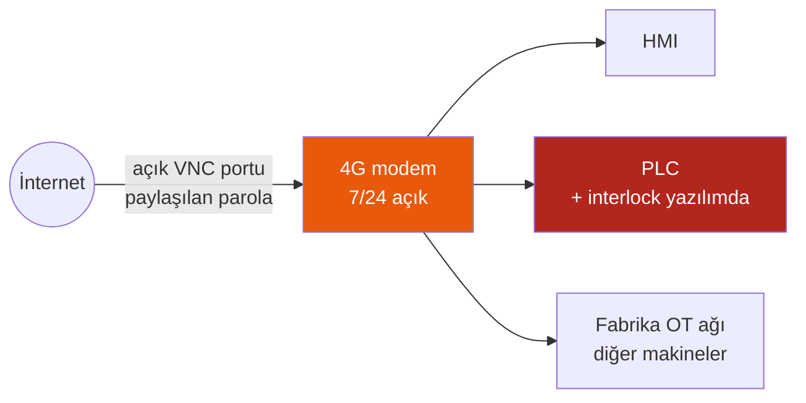
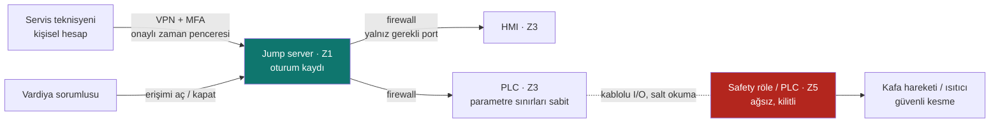

# LAB 4 · Secure Remote Access — Cliopack TS-100

**Çıktı:** Secure Architecture → Evidence Pack **EP 02 + EP 06**

| Ad Soyad | Grup | Tarih |
|---|---|---|
| Ensar Daş | | 23.10.2026 |

> Kavram: İki katmanın ikisi de şarttır.
> 1. **Erişim güvenliği:** girişi zorlaştırır (ara nokta, VPN, MFA, kişisel hesap, kayıt, varsayılan kapalı).
> 2. **Emniyet bağımsızlığı:** saldırgan içeri girse bile insan korunur.

## Görev A — mevcut → hedef

### MEVCUT (varsayımsal, tipik saha durumu)

- Servis firması arıza ve reçete desteği için makine panosuna bir **4G modem** koymuş; modem **7/24 açık**.
- HMI'a **VNC/uzak masaüstü** ile doğrudan bağlanılıyor; port internete açık, **paylaşılan parola** (ör. `service / 1234`).
- Modem fabrika ağına da bağlı (MES için). Böylece internet → modem → fabrika OT ağı → diğer makineler yolu açık.
- **MFA yok, oturum kaydı yok**; kimin, ne zaman, hangi parametreyi değiştirdiği bilinmiyor.
- Çekmece interlock'u normal PLC programında çözülmüş (varsayım), aşırı sıcaklık limiti HMI menüsünden ayarlanabiliyor.

### HEDEF (beş ilke + emniyet bağımsızlığı)

| İlke | Hedef tasarım |
|---|---|
| **1. Ara nokta** | Servis firması makineye doğrudan bağlanmaz. Tüm erişim OT DMZ'deki (Z1) **jump server** üzerinden geçer. 4G modem kaldırılır ya da yalnızca DMZ'ye giden tünel olarak kullanılır. |
| **2. VPN** | İnternetten yalnızca şifreli VPN tüneli kabul edilir; internete açık port (VNC/RDP) kalmaz. |
| **3. MFA + kişisel hesap** | Her teknisyenin kendi adına hesabı ve ikinci faktörü olur. Paylaşılan `service` hesabı silinir. Yetkiler rol bazlıdır: "izle" ve "parametre değiştir" ayrıdır. |
| **4. Kayıt** | Jump server'da tam oturum kaydı (ekran + komut), PLC/HMI'da parametre değişikliği logu. Loglar merkezi ve değiştirilemez bir yerde 1 yıl tutulur. |
| **5. Varsayılan kapalı** | Erişim normalde kapalıdır. Vardiya sorumlusu iş emri ile belirli bir süre için açar (ör. 2 saat), süre bitince bağlantı otomatik kesilir. Üretim sırasında uzaktan parametre yazma kilitlidir; yalnızca izlemeye izin verilir. |
| **+ Segmentasyon** | TS-100 kendi hücre bölgesinde (Z3) durur; diğer makinelere yatay geçiş firewall ile engellenir. |
| **+ Emniyet bağımsızlığı** | Emniyet fonksiyonları (E-stop, çekmece interlock, aşırı sıcaklık kesmesi) ağdan bağımsız Z5 bölgesindedir (bkz. Görev B). |

## Görev B — functional safety köprüsü

### 1 · Saldırgan tüm önlemlere rağmen içeri girerse: emniyet fonksiyonu etkilenir mi? Neden?

**Hedef mimaride hayır, emniyet fonksiyonu etkilenmez.** Çekmece interlock'u, acil stop ve aşırı sıcaklık kesmesi, ağa bağlı olmayan, kablolu ve programı kilitli bir emniyet rölesi/Safety PLC üzerinden **doğrudan enerjiyi** (kafa valfi havası, ısıtıcı kontaktörü) keser. Saldırgan PLC'ye veya HMI'a ulaşsa bile emniyet zincirine yazacak bir yolu yoktur. Çekmece açıkken kafa inemez, sıcaklık limiti aşılırsa ısıtıcı kesilir.

**Etkilenebilecek olanlar:** Reçete parametreleri (kapatma kalitesi → gıda güvenliği, Lab 3 R1) ve üretimin durması. Bu yüzden ikinci katman (erişim güvenliği) ve kalite kontrolü (numune sızdırmazlık testi, parametre sınırları) yine gereklidir.

**Mevcut mimaride ise evet etkilenir:** Interlock normal PLC yazılımında olduğu için PLC'yi ele geçiren saldırgan interlock'u da devre dışı bırakabilir (Lab 3 R2).

### 2 · Emniyet fonksiyonunun kontrol sisteminden bağımsız çalışması için GEREKSİNİM (çözüm değil)

| No | Gereksinim |
|---|---|
| **GR-1** | Emniyet fonksiyonları (SF1 çekmece interlock, SF2 acil stop, SF3 aşırı sıcaklık kesmesi), normal kontrol sistemi (PLC, HMI, ağ) **arızalandığında, ele geçirildiğinde veya kapatıldığında** da belirlenen PLr'yi (SF1: PL d) sağlamaya devam etmelidir. |
| **GR-2** | Normal kontrol sistemi ve ona bağlı herhangi bir ağ/uzak erişim kanalı, emniyet fonksiyonunun çıkışlarını **etkinleştirmemeli, geciktirmemeli veya devre dışı bırakmamalıdır**. İzin verilen tek yön emniyetten kontrole doğru durum bilgisidir. |
| **GR-3** | Emniyet fonksiyonunun parametreleri (limit sıcaklık, durdurma kategorisi, interlock mantığı) **uzaktan ve operatör panelinden değiştirilememelidir**. Değişiklik yalnızca yerinde, yetkili kişi tarafından, kayıt altında yapılabilmeli ve sonrasında yeniden doğrulama (validasyon) gerektirmelidir. |
| **GR-4** | Emniyet yazılımının/konfigürasyonunun bütünlüğü (ör. checksum) her açılışta doğrulanabilmeli; uyumsuzlukta makine güvenli durumda kalmalıdır. |
| **GR-5** | Enerji, basınçlı hava veya iletişim kesildiğinde ya da geri geldiğinde makine **güvenli durumda** kalmalı ve kendiliğinden yeniden başlamamalıdır. |
| **GR-6** | Emniyet fonksiyonu tetiklendiğinde olay (zaman, sebep) silinemeyen biçimde kayıt altına alınabilmelidir (olay müdahalesi ve CRA kanıtı için). |

> *Tarafsızlık notu:* Bu föy çözüm tasarlatmaz, gereksinimi tanımlatır. Hangi donanımla karşılanacağına firma karar verir.

*Bu föy bir eğitim çıktısıdır; resmî denetim, uygunluk değerlendirmesi veya belgelendirme değildir.*
